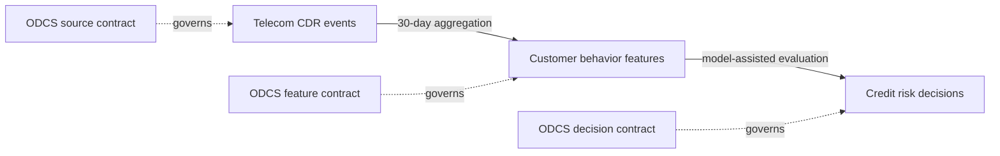

# Governance as Code with ODCS Data Contracts

[](https://github.com/hakigreg/odcs-governance-as-code/actions/workflows/ci.yaml)


[](LICENSE)

Governance-as-code reference implementation for regulated analytics and AI,
built with Open Data Contract Standard (ODCS) v3.2.0.

## The problem

Schema definitions alone do not establish whether data is trustworthy or safe to
use. Teams also need explicit ownership, quality expectations, service levels,
compatibility guarantees, and usage constraints that can be checked during
delivery and operation.

This project demonstrates how ODCS data contracts can turn those governance
requirements into executable controls.

## What this project demonstrates

| Control | Implementation | Evidence |
| --- | --- | --- |
| ODCS conformance | [`scripts/lint_contracts.py`](scripts/lint_contracts.py) | [`Contract CI`](.github/workflows/ci.yaml) |
| Governance policy | [`scripts/check_governance.py`](scripts/check_governance.py) | [`Contract CI`](.github/workflows/ci.yaml) |
| Contract compatibility | [`scripts/check_compatibility.py`](scripts/check_compatibility.py) | [Breaking-change demonstration](docs/compatibility.md) |
| Runtime data quality | PostgreSQL and Data Contract CLI | [Runtime scenarios](docs/runtime-validation.md) |

## MVP

The MVP contains three connected data contracts:

1. `telecom_cdr_events` — pseudonymous telecom activity produced by the Telecom domain.
2. `customer_behavior_features` — aggregated features produced by the Data Platform domain.
3. `credit_risk_decisions` — explainable risk outputs produced by Risk Analytics.

Every pull request passes four gates:

- ODCS conformance
- organizational governance policies
- backward-compatibility checks
- runtime schema and data-quality tests

See [MVP scope](docs/mvp-scope.md) for the definition of done.

## Architecture



Each boundary has a separate owner, PostgreSQL schema, service level, usage
constraints, and runtime evidence. See the [architecture](docs/architecture.md)
and [contract lifecycle](docs/lifecycle.md).

## Prerequisites

- Git
- Docker with Docker Compose
- Make

Python runs inside the project container, so no compatible local Python version
is required.

## Development commands

```bash
make help
make bootstrap
make check
make demo
```

## Implemented contracts

### `telecom_cdr_events` v1.0.0

The source-aligned contract governs pseudonymous call, message, and data-session
events. It defines ownership, classification, quality rules, service levels,
access roles, and explicit usage constraints for analytics and AI consumers.

See the [contract](contracts/telecom_cdr_events/v1.0.0.odcs.yaml) and its
[architecture decision](docs/decisions/001-telecom-cdr-contract.md).

### `customer_behavior_features` v1.0.0

The derived contract turns governed telecom events into reproducible 30-day
feature snapshots. It makes source lineage, semantic dimensions and measures,
transformation logic, ownership, privacy constraints, and feature service levels
reviewable as code.

See the [contract](contracts/customer_behavior_features/v1.0.0.odcs.yaml) and its
[architecture decision](docs/decisions/002-customer-behavior-features-contract.md).

### `credit_risk_decisions` v1.0.0

The decision contract separates model recommendation from final outcome and
records point-in-time feature lineage, model version, explanation reason, and
human-review evidence. Its executable controls reject future feature snapshots,
inconsistent score bands, and adverse outcomes without completed review.

See the [contract](contracts/credit_risk_decisions/v1.0.0.odcs.yaml) and its
[architecture decision](docs/decisions/003-credit-risk-decisions-contract.md).

## Runtime demonstrations

Run the complete governed chain against live PostgreSQL tables:

```bash
make demo
```

The command validates all three boundaries. To isolate the source contract, run:

```bash
make demo-source
```

Then prove that its gate rejects semantic quality violations:

```bash
make demo-quality-failure
```

The second command is expected to exit with a non-zero status. See
[runtime validation](docs/runtime-validation.md) for the scenarios and design boundary.

Build the governed feature table from valid source events and validate the
derived contract:

```bash
make demo-features
```

Then prove that the derived boundary rejects transformation defects while its
upstream input remains valid:

```bash
make demo-features-quality-failure
```

Execute the complete source-to-decision path:

```bash
make demo-decisions
```

Finally, prove that decision controls reject point-in-time, consistency, and
human-oversight violations without invalidating the upstream features:

```bash
make demo-decisions-quality-failure
```

## Compatibility gate

Conformance does not guarantee that consumers can safely adopt a new contract
version. The compatibility gate compares consecutive versions and rejects
removed fields, type or key changes, tightened requirements, enum changes, and
more restrictive classifications:

```bash
make compatibility-check
```

Demonstrate an incompatible feature removal without changing files on disk:

```bash
make demo-breaking-change
```

This command is expected to exit with a non-zero status. See
[contract compatibility](docs/compatibility.md) for the policy and trade-offs.

## Continuous integration

[GitHub Actions](.github/workflows/ci.yaml) runs the same gates on every push and
pull request. Its runtime job validates all three green paths and confirms that
the expected quality and compatibility failures occur for the documented
reasons:

```bash
make ci-runtime
```

See the [continuous integration design](docs/continuous-integration.md).

For a reviewer-friendly walkthrough with expected evidence, follow the
[portfolio demonstration guide](docs/demo-guide.md).

## Minimum governance gate

ODCS conformance is necessary but not sufficient for this project. The repository
also applies a transparent organizational policy covering ownership, support,
service levels, classification, Critical Data Elements, credentials, and AI-use
constraints:

```bash
make governance-check
```

See the [minimum viable governance policy](docs/governance-policy.md).

## Status

The MVP is implemented and continuously validated on GitHub: all three contract
boundaries, runtime demonstrations, breaking-change detection, lifecycle
documentation, and CI are in place.

## Disclaimer

This repository uses synthetic data and simplified policies for educational and
portfolio purposes. All organizations, domains, owners, and `example.com`
contact addresses are fictitious. It does not constitute legal, regulatory,
credit, or risk management advice.
