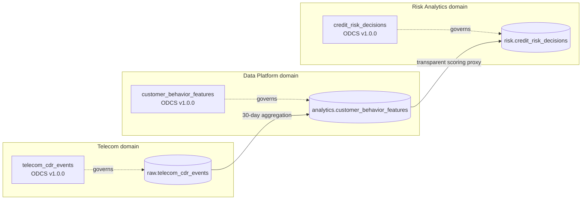
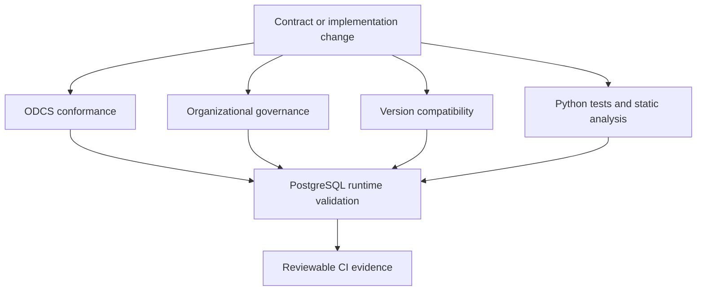

# Architecture

The MVP models governance as a chain of three independently owned data
interfaces. Each team publishes an ODCS contract at its boundary instead of
sharing an undocumented table or relying on pipeline code as the specification.

## Responsibility boundaries

| Boundary | Accountable domain | Contract responsibility | Runtime evidence |
| --- | --- | --- | --- |
| Source events | Telecom | Event semantics, pseudonymization, event quality, freshness | 40 checks |
| Behavioral features | Data Platform | Aggregation logic, point-in-time window, feature version, lineage | 48 checks |
| Risk decisions | Risk Analytics | Model lineage, explanation, review state, final outcome | 69 checks |

Failures are assigned to the team that owns the affected boundary. The negative
feature scenario starts with valid CDRs; the negative decision scenario starts
with valid features. This makes accountability testable rather than implied.

## Control architecture

The four logical gates are:

1. **Conformance** — every document parses against the official ODCS v3.2.0 model.
2. **Governance** — local ownership, classification, SLA, lineage, explainability,
   and human-oversight rules are enforced.
3. **Compatibility** — unsafe interface changes are rejected before merge.
4. **Runtime** — physical schema, data quality, freshness, retention, and semantic
   consistency are checked against live PostgreSQL tables.

## Runtime topology

Docker Compose provides two isolated services:

- PostgreSQL 16 stores the `raw`, `analytics`, and `risk` schemas in a named volume.
- The tooling container runs Python 3.12, Data Contract CLI, policy checks, tests,
  and scenario materialization.

PostgreSQL is not published to a host port. Tooling connects through the Compose
network, while credentials are supplied as runtime environment variables and
never embedded in an ODCS document.

## Deliberate boundaries

The scoring function is deterministic and transparent; it demonstrates contract
execution but is not a trained model. The project does not implement production
identity resolution, credit policy, regulatory notices, model approval, or a
contract registry. All records are synthetic.
