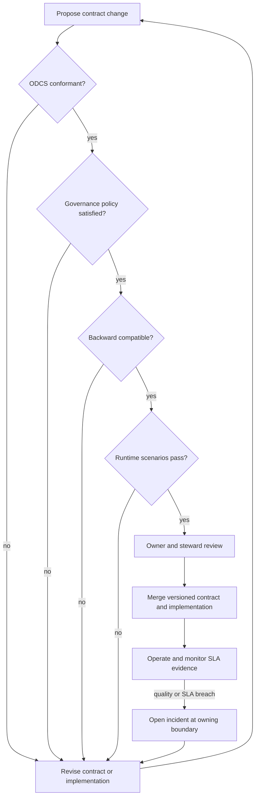

# Data contract lifecycle

The lifecycle treats a contract as a versioned interface with named owners,
automated acceptance criteria, and runtime evidence.

## Lifecycle stages

### 1. Propose

The producing domain changes the contract and implementation together. Every
contract version keeps a stable `id`, explicit semantic version, owner, steward,
support channel, usage constraints, and quality rule identifiers.

### 2. Validate

`make check` provides fast feedback without starting the database:

- Ruff checks Python sources.
- Data Contract CLI validates ODCS conformance.
- The organizational policy engine checks minimum governance.
- The compatibility engine compares consecutive versions.
- Pytest exercises policy, lineage, scenarios, and compatibility rules.

### 3. Prove runtime behavior

`make demo` materializes the entire chain and tests all three live interfaces.
Expected-failure targets prove that each boundary rejects known semantic defects.
CI accepts a negative scenario only when the command fails and the exact expected
number of failed checks appears in its output.

### 4. Review and release

The contract Owner approves purpose, risk, and lifecycle decisions. The Data
Steward reviews semantics, classification, lineage, and quality expectations.
Technical reviewers verify implementation and runtime evidence. A breaking
change requires an explicit migration rather than bypassing the gate.

### 5. Operate and evolve

Runtime checks supply evidence for freshness, retention, schema, and quality.
Incidents are routed to the support channel of the failing boundary. A new
compatible version is added beside its predecessor so CI can evaluate the
transition; older versions remain available until consumers migrate.

## Versioning policy

- `PATCH`: documentation or control corrections without interface changes.
- `MINOR`: compatible additions, such as an optional property.
- `MAJOR`: intentionally breaking interface change with a documented migration.

The current compatibility gate still rejects breaking changes after a major
version increment. This is deliberate: a major number communicates intent but
does not prove that producers and consumers have completed migration. An
approved migration workflow would be a post-MVP extension.
